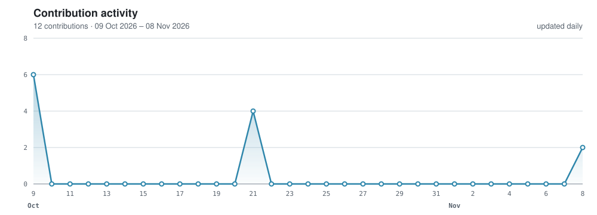

<h1 align="center">Cássio Moquedace</h1>

  

  &nbsp;
  &nbsp;
  &nbsp;
  &nbsp;
  &nbsp;
  
    
  &nbsp;
  &nbsp;
  &nbsp;
  

---

### About

I am a Postdoctoral Researcher at ESALQ/USP (Luiz de Queiroz College of Agriculture,
University of São Paulo), working with the GeoCiS group in the Department of Soil Science,
with a FAPESP fellowship (2025/00139-6) linked to the Center for Carbon Research in Tropical
Agriculture (CCARBON). My project maps the spatial and temporal variation of soil organic
carbon across Brazil. I hold a Ph.D. in Soil Science and Plant Nutrition from the Federal
University of Viçosa (2025).

My research applies **machine learning**, **deep learning**, and **artificial intelligence**
to soil science — developing reproducible workflows for spatial prediction, digital mapping,
and understanding soil carbon dynamics across diverse environments and scales.

### Research Focus

- Digital soil mapping and pedometrics
- Soil organic carbon stock mapping and dynamics
- Biota–soil–climate interactions at the global scale
- Machine learning and deep learning for soil property prediction, interpreted with Shapley values and partial dependence
- Remote and proximal sensing: VIS-NIR spectroscopy, gamma-ray spectrometry and magnetic susceptibility
- Soils of the Amazon and Antarctica
- Reproducible research pipelines in R

### Selected Projects

| Project | Focus | Paper / release |
|---|---|---|
| [`soilcnn`](https://github.com/moquedace/soilcnn) | CNNs for digital soil mapping in R: spatial CV, seed ensembles, conformal intervals and area of applicability |  · [docs](https://moquedace.github.io/soilcnn/) · [DOI](https://doi.org/10.32614/CRAN.package.soilcnn) |
| [`global_soil_respiration`](https://github.com/moquedace/global_soil_respiration) | Soil texture and global soil respiration modeling | [Sci. Total Environ. 2026](https://doi.org/10.1016/j.scitotenv.2026.181663) |
| [`soc_stock_antarctica`](https://github.com/moquedace/soc_stock_antarctica) | Soil organic carbon stock mapping in Antarctica | [Commun. Earth Environ. 2025](https://doi.org/10.1038/s43247-024-01937-z) |
| [`ro_soil_carbon_stock`](https://github.com/moquedace/ro_soil_carbon_stock) | High-resolution soil carbon stock mapping in the western Amazon | [Geoderma Regional 2024](https://doi.org/10.1016/j.geodrs.2024.e00773) |
| [`funcs`](https://github.com/moquedace/funcs) | R functions for spatial modeling, raster workflows and prediction pipelines | — |

### Tools & Stack

  
  
  
  
  
  

  <code>machine learning</code> · <code>deep learning</code> · <code>pedometrics</code> · <code>digital soil mapping</code> · <code>remote sensing</code> · <code>spatial modeling</code> · <code>soil carbon</code>

---

  

---

  Soil data · Carbon dynamics · Maps · Models · Reproducible science

